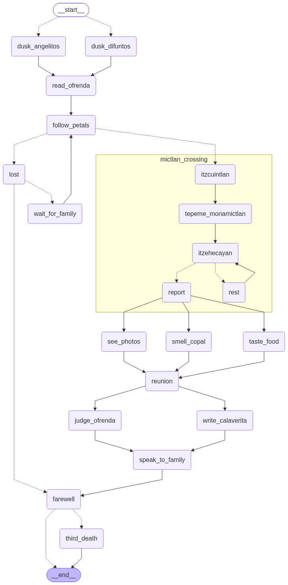

# El Regreso

> *One night, every year.*
> A stateful **LangGraph** agent built around Día de los Muertos: nodes, edges, interrupts, subgraphs
> and persistent **checkpointing**.

🇦🇿 [Azərbaycan dilində](README.az.md)

## What it does

A spirit returns home on the night of 1–2 November. It goes through these steps:

1. finds the marigold petal path
2. crosses the levels of Mictlán
3. "tastes" the altar offerings
4. talks to its family
5. leaves again, until next year

When the same `thread_id` returns the following year, the spirit **remembers previous visits**:

> *"I recognized the door, Abuela Remedios. The table was empty, but the road I came by was not.
> **You haven't brought a photo for 3 years.** I'm not asking, just saying."*

The "3 years" is **not generated by the model**. It is computed from the `visits` field restored by the
checkpointer, and the LLM only turns facts into a sentence. That is the core design principle: **facts
come from state, not from the model**, so even the offline fallback tells the same truth.



## LangGraph features used

| Concept | LangGraph |
|---|---|
| Altar (ofrenda) | `State` (`TypedDict`) with three different reducers |
| Placing an item on the altar | `update_state()` / `Command(resume=...)` |
| Petal path | edges |
| 1 vs 2 November route | `add_conditional_edges(START, ...)` |
| A lost spirit waits for a human | `interrupt()` |
| Levels of Mictlán | subgraph |
| A spirit waiting all year | `SqliteSaver` + `thread_id` |
| Past visits | `get_state_history()` |
| Alternate timeline | `update_state()` on an old `checkpoint_id` → new branch |
| The "third death" (being forgotten) | `delete_thread()` |

Other details:

- **Node types:** five kinds of node: pure function, tool, interrupt, parallel and LLM.
  `graph.py` contains only nodes and edges, with no business logic.
- **Structured output:** LLM judgement via `with_structured_output(...)`.
- **Crash recovery:** `solution/chaos.py` kills the process mid-run and resumes it from the last
  checkpoint.
- **Provider failover chain:**
  1. Groq `gpt-oss-120b`
  2. Groq `gpt-oss-20b`
  3. Gemini
  4. OpenAI `gpt-4o-mini`
  5. offline templates

  On a quota or rate-limit error, the next provider takes over automatically. Without any key, the
  app never crashes.

## Live visualization

A FastAPI + WebSocket web UI, hand-made with no frontend library, shows:

- **The live graph and a LangGraph journal** with the real call behind every event, e.g.
  `graph.stream(...)`, `interrupt(...)`, `update_state(checkpoint_id=...)`, `delete_thread(...)`.
- **A clickable checkpoint timeline:** pick any moment, change the altar, and fork an alternate story.
  The original branch stays intact, and both outcomes are compared side by side.
- **Interactive altar, spirit cards and a memory album** of past visits.
- **Character voices:** text is translated to Spanish and voiced with Gemini TTS, with a voice chosen
  per character.

## Run it

```bash
pip install -r requirements.txt
```

```bash
cp .env.example .env
```

Add any of `GROQ_API_KEY`, `GOOGLE_API_KEY` or `OPENAI_API_KEY` to `.env`. Then start it:

```bash
python main.py
```

This starts the web UI and opens the browser. An empty database is seeded with demo history.

```bash
python main.py --demo
```

Runs a 5-year demo in the terminal.

```bash
python -m solution.run_year --soul abuela --year 2024
```

Runs one year. In 2024 the spirit gets lost, so the graph stops at `interrupt()`.

```bash
python -m solution.run_year --soul abuela --resume --gift cempasúchil
```

A human resumes the run.

```bash
python -m solution.run_year --soul abuela --history
```

Shows the checkpoint history.

```bash
python -m solution.run_year --soul abuela --fork 7 --gift şəkil
```

Forks an alternate timeline from a checkpoint.

```bash
python -m solution.chaos
```

Kills the process and resumes it.

## Structure

```
main.py         single entry point
solution/
  state.py      state schema + reducers
  nodes.py      node implementations
  crossing.py   Mictlán crossing (subgraph)
  graph.py      nodes and edges only
  voice.py      LLM layer with provider failover and offline fallback
  run_year.py   CLI + all checkpointing operations
  chaos.py      kill / resume test
web/            FastAPI + WebSocket server, static visualization
altar/          yearly offering files per spirit
tests/          story tests
```

## License

MIT
